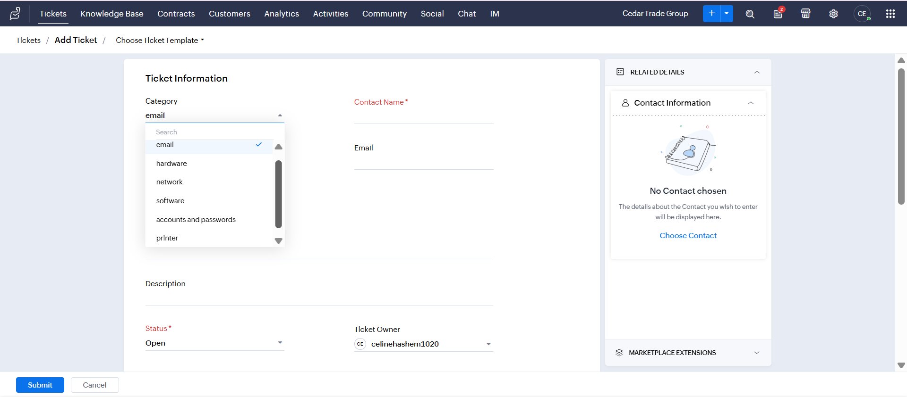
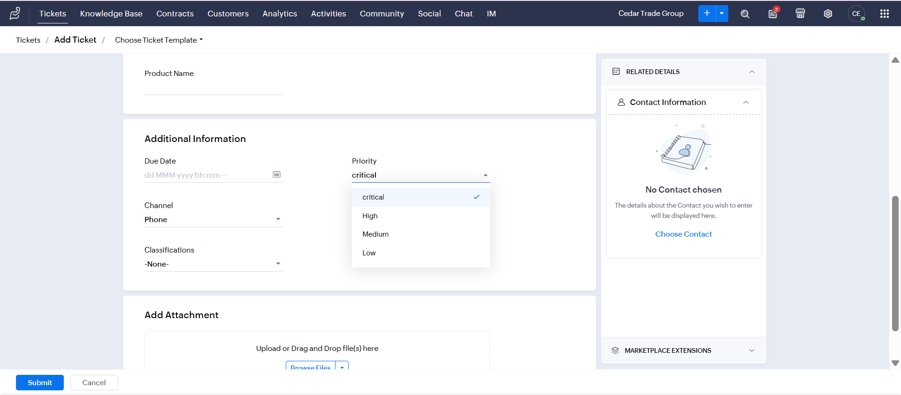
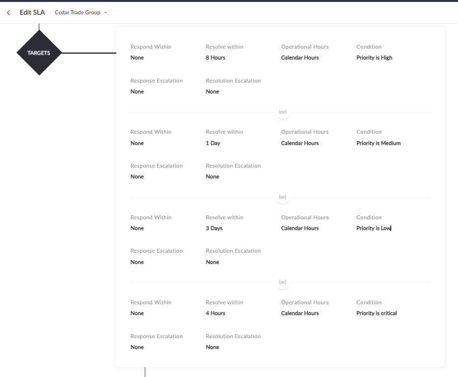
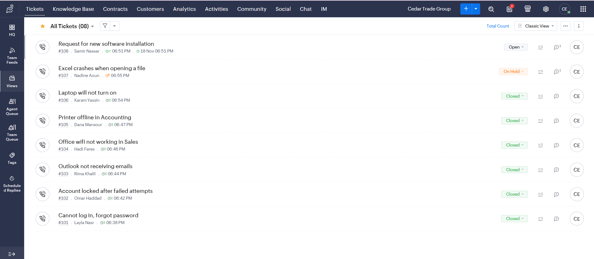
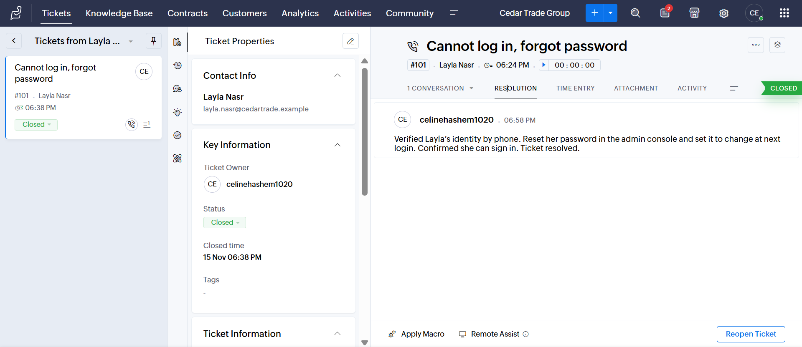
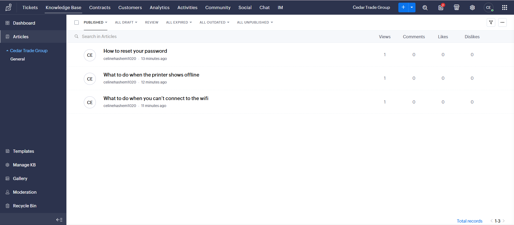
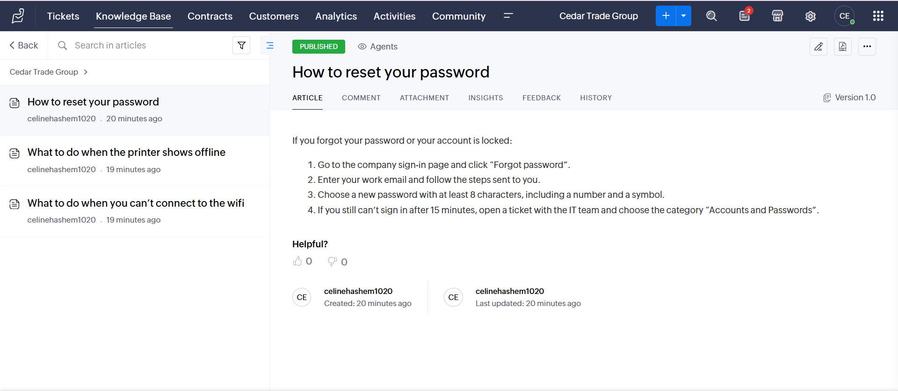

# Cloud Service Desk Setup (Zoho Desk)

A hands-on IT support project: I configured a real cloud help desk tool for the fictional company Cedar Trade Group, then created and handled support tickets in it. It is the implementation of the ticket system I designed in my [IT Help Desk Management System](https://github.com/celine708/it-help-desk-system) project.

**Author:** Celine Hashem | **Tool:** Zoho Desk (free Enterprise trial) | **Type:** Personal project (fictional company, made-up users)

## Overview

In the Help Desk project I wrote the requirements and built a ticket database. In this project I set up the same rules in a real service desk tool and worked through realistic tickets, the way an IT support technician would.

**What I did:**
- Configured 6 ticket categories and 4 priorities from the requirements
- Set resolution deadlines (SLAs) for each priority
- Created and handled 8 tickets and recorded the fix for each solved one
- Wrote 3 Knowledge Base articles for common problems

## Configuration

**Categories:** Email, Hardware, Network, Software, Accounts and Passwords, Printer

**Priorities:** Critical, High, Medium, Low

**Deadlines (SLA)**, using calendar hours as in the original requirements:

| Priority | Resolve within |
| --- | --- |
| Critical | 4 hours |
| High | 8 hours |
| Medium | 24 hours (1 day) |
| Low | 72 hours (3 days) |

## Tickets

I created 8 tickets from made-up employees (all emails use `@cedartrade.example`). Six are closed, one is on hold, and one is open.

| Employee | Problem | Category | Priority | Status |
| --- | --- | --- | --- | --- |
| Layla Nasr | Cannot log in, forgot password | Accounts and Passwords | High | Closed |
| Omar Haddad | Account locked after failed attempts | Accounts and Passwords | Medium | Closed |
| Rima Khalil | Outlook not receiving emails | Email | High | Closed |
| Hadi Fares | Office wifi not working in Sales | Network | Critical | Closed |
| Dana Mansour | Printer offline in Accounting | Printer | Medium | Closed |
| Karam Yassin | Laptop will not turn on | Hardware | High | Closed |
| Nadine Aoun | Excel crashes when opening a file | Software | Low | On Hold (waiting for the user's file) |
| Samir Nassar | Request for new software installation | Software | Low | Open (waiting for approval) |

Each closed ticket has a resolution note describing the fix, so repeated problems can be solved faster. Example:

**Examples of fixes recorded:** password reset after an identity check, unlocking an account, clearing a full mailbox, restarting a wifi access point, re-adding an offline printer, replacing a failed laptop charger.

## Knowledge Base

I wrote three short self-service articles for the most common problems, which supports the recommendation from my Help Desk project to offer self-service password resets.

- How to reset your password
- What to do when the printer shows offline
- What to do when you can't connect to the wifi

## Lessons learned

- Zoho's default ticket statuses are Open, On Hold, Escalated, and Closed, so I used Closed as the "resolved" state and On Hold for a ticket waiting on the user.
- SLA targets are built from the values of the Priority field, so the priorities have to be set up before the deadlines.
- Categories had to be added to the ticket layout before they appeared on the form.
- The Resolution field is separate from ticket comments. I used it for the final fix so it can be reused as knowledge.

## Limitations

- All company, employee, and ticket data is fictional.
- I used Zoho Desk's free Enterprise trial. Some features used here, such as SLAs, may not be available on the permanent free plan, so check Zoho's current plans.
- All tickets were handled by the admin account. The other technicians from the Help Desk project were not set up in this trial portal.
- Resolution deadlines use calendar hours, not working hours. 
